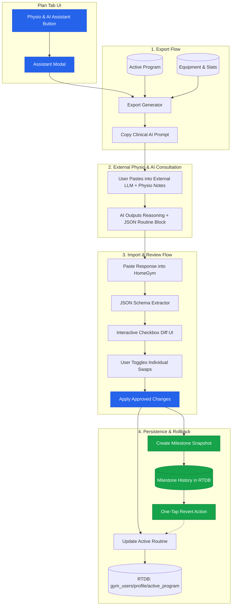
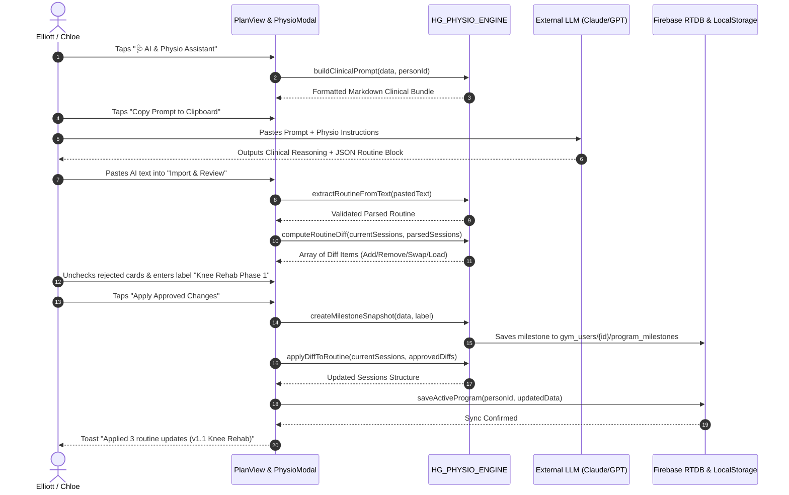

# Plan: Physio & AI Routine Exchange Loop

## Goal Capsule

- **Objective**: HomeGym users can safely adapt their multi-week training routines to physiotherapist guidance using external AI assistance without manual re-entry or risking routine data loss.
- **Means**: Add a Physio & AI Routine Assistant modal in the Plan tab featuring clinical prompt export, interactive checkbox diff review for AI suggestions, and automated program version milestones with one-tap rollback.
- **Product Authority**: Elliott (User / Product Owner).
- **Open Blockers**: None.

## Product Contract

*Product Contract unchanged.*

### Summary

HomeGym adds a two-way routine exchange modal in the Plan tab. Users export their active split, current weights, and equipment profile into a structured prompt for external AI, then paste the AI recommendations back into HomeGym to review and cherry-pick exercise substitutions via an interactive diff before committing changes alongside an automatic safety milestone snapshot.

### Problem Frame

Adapting training routines during injury rehabilitation requires balancing clinical guidance with existing strength progress. Manually updating exercise entries, target sets, and weights across multi-day splits is tedious and prone to transcription errors. Users hesitate to alter established routines due to fear of losing their dialed-in weights or corrupting historical workout data. Without structured AI prompt generation, external models lack context on available equipment and current loads, frequently suggesting contraindicated movements or impossible setups.

### Key Decisions

- **Plan Tab Modal Placement**: Dedicated "Physio & AI Routine Assistant" modal launched from the Plan tab rather than the active workout runner or a separate bottom navigation tab `(session-settled: user-directed — chosen over active workout modal or standalone nav tab: keeps routine planning contextual and separate from active gym floor logging)`. Governs R1.
- **Full Clinical Bundle Prompt Format**: Export payload packages active split structure, current working weights/reps, available equipment, recent fatigue/soreness ratings, and strict regression instructions `(session-settled: user-directed — chosen over simple routine text export: equips external AI with complete context to avoid prescribing contraindicated or unfeasible exercises)`. Governs R2, R3.
- **Interactive Checkbox Diff Review**: User reviews proposed additions, modifications, and swaps on visual cards with default-checked toggle boxes before applying `(session-settled: user-directed — chosen over all-or-nothing replace or manual copy-pasting: gives user granular control to reject specific exercise swaps)`. Governs R4, R5, R6.
- **Program Version Milestones & One-Tap Revert**: Saving changes automatically creates a named snapshot of the previous routine, allowing one-tap revert without ever altering historical workout logs or PRs `(session-settled: user-directed — chosen over unversioned overwrite or manual export files: guarantees safety and peace of mind when experimenting with rehabilitation changes)`. Governs R7, R8.

### Actors

- A1. HomeGym Lifter (Elliott / Chloe): Exports current routine, consults external AI with physio instructions, reviews proposed diffs, and executes adapted workouts.
- A2. External AI Assistant (Claude, ChatGPT, Gemini): Consumes the clinical bundle prompt alongside physiotherapist advice, computes exercise substitutions, and produces a structured replacement payload.
- A3. Physiotherapist / Clinician: Provides real-world rehabilitation constraints, loading restrictions, and substitute movement recommendations.

### User Scenarios & Key Flows

- F1. Clinical Routine Export
  - **Trigger**: User opens Plan tab and taps "Physio & AI Assistant".
  - **Actors**: A1
  - **Steps**:
    1. User taps "Export for AI".
    2. System packages the active routine, current exercise working loads, available equipment, and safety guardrails into a markdown prompt.
    3. User taps "Copy Prompt to Clipboard" and pastes into their AI chat alongside recent physio notes.
  - **Outcome**: External AI receives full context to make safe, equipment-accurate recommendations.
  - **Covered by**: R1, R2, R3

- F2. AI Response Import & Interactive Diff Review
  - **Trigger**: External AI outputs replacement recommendations with a structured JSON code block.
  - **Actors**: A1, A2
  - **Steps**:
    1. User copies the AI response text and returns to HomeGym's assistant modal.
    2. User taps "Import & Review AI Changes" and pastes the text into the input field.
    3. Parser isolates and validates the routine schema, extracting changes against the current active routine.
    4. Review view presents cards highlighting additions (green), removals (red), weight adjustments (blue), and exercise swaps.
    5. User unchecks any swap they want to reject and gives the new version a milestone label (e.g., "Knee Rehab Phase 1").
    6. User taps "Apply Approved Changes".
  - **Outcome**: Active routine updates with approved modifications and syncs to Firebase RTDB.
  - **Covered by**: R4, R5, R6

- F3. Safety Rollback & Milestone Management
  - **Trigger**: User experiences flare-ups or finishes rehabilitation and desires to return to baseline routine.
  - **Actors**: A1
  - **Steps**:
    1. User opens the "Version Milestones" section in the assistant modal.
    2. User views the list of timestamped routine snapshots.
    3. User selects a previous milestone and taps "Revert to this Version".
    4. System activates the snapshot as the current active routine while preserving all historical workout logs and PR records.
  - **Outcome**: Immediate routine restoration with zero loss of logged training history.
  - **Covered by**: R7, R8

### Requirements

#### Modal Shell & Entry
- R1. The Plan tab displays an action button to open the Physio & AI Routine Assistant modal.

#### Export Payload & Clinical Formatting
- R2. The export generator bundles the active split days, exercise names, current working weights, target sets/reps, and available home gym equipment into a formatted markdown prompt.
- R3. The export generator includes clinical prompt instructions directing the external AI to output reasoning first followed by an unambiguous JSON replacement block.

#### Import Validation & Interactive Diff Review
- R4. The import parser extracts and validates routine JSON data embedded within conversational text or markdown code fences.
- R5. The review screen renders each proposed addition, deletion, load adjustment, and exercise substitution on an individual card with a toggle checkbox defaulted to checked.
- R6. Applying approved changes updates the user's active routine in local storage and commits the updated routine to Firebase RTDB under `gym_users/${profileId}/active_program`.

#### Program Version Milestones & History Safety
- R7. The milestone manager creates an immutable snapshot of the active routine with an optional user-defined label before applying imported changes.
- R8. The milestone manager displays previous snapshots with a one-tap rollback action that restores the selected routine without modifying historical workout logs or PR entries.

### Visualizations



### Acceptance Examples

- AE1. Clinical Prompt Clipboard Generation
  - **Covers**: R2, R3
  - **Given**: Elliott's active program has "Day 1 - Push" with "Barbell Bench Press (3x8 @ 75kg)" and equipment set to "Power Rack, Barbell, Adjustable Dumbbells, Bench".
  - **When**: Elliott taps "Export for AI" in the assistant modal.
  - **Then**: The clipboard receives a prompt containing the active day list, the 75kg bench baseline, the available equipment list, and explicit instructions requiring the AI to provide exercise substitutions in a valid JSON routine block.

- AE2. Robust Import Schema Extraction with Commentary
  - **Covers**: R4
  - **Given**: Elliott pastes an AI response containing 4 paragraphs of clinical justification followed by a ```json ... ``` code fence containing revised sessions.
  - **When**: The import parser processes the pasted text.
  - **Then**: The parser isolates the JSON block, validates session and exercise IDs, and successfully transitions to the diff view without schema errors.

- AE3. Granular Exercise Cherry-Picking Diff
  - **Covers**: R5, R6
  - **Given**: The AI recommends substituting Barbell Back Squat with Goblet Squat and substituting Bulgarian Split Squats with Leg Extensions.
  - **When**: Elliott unchecks the Leg Extension substitution card while leaving Goblet Squat checked, then taps "Apply Changes".
  - **Then**: HomeGym applies the Goblet Squat swap to Day 2, leaves Bulgarian Split Squats unchanged, and syncs the updated active program to Firebase RTDB.

- AE4. One-Tap Milestone Reversion Preserves Workout Logs
  - **Covers**: R7, R8
  - **Given**: Elliott has completed 5 logged workouts under milestone "v1.1 Knee Rehab" and decides to return to "v1.0 Baseline".
  - **When**: Elliott opens Version Milestones and taps "Revert to this Version" on "v1.0 Baseline".
  - **Then**: The active routine immediately reverts to the v1.0 baseline structure, and all 5 completed rehabilitation workout logs in `gym_users/ejcallender/logs` remain intact.

### Scope Boundaries

#### In Scope (v1)
- Assistant modal accessible from Plan tab.
- Markdown prompt generator packaging split, working loads, equipment, and clinical guardrails.
- Robust markdown/text JSON extractor tolerant of surrounding LLM text.
- Interactive diff UI with individual card-level checkboxes for each suggested change.
- Automated snapshot milestone creation on every applied change.
- One-tap milestone rollback restoring previous routine definitions.
- Full Firebase RTDB synchronization preserving historical logs and PR records.

#### Deferred for Later
- Direct in-app LLM API calling via user-provided API keys (v1 focuses on frictionless copy-paste).
- Physio voice memo transcription or audio recording uploads.
- Automated wearable strain/HRV integration for auto-adjusting volume.

#### Outside Product Identity
- Autonomous medical diagnostic prescription (HomeGym provides training tools, not medical advice).
- Destructive auto-overwrites without explicit user review.

<!-- ce-section: work-relationships -->
### How This Work Fits Together

This plan covers the routine evolution workflow between external clinical advice and HomeGym's active training schedule.

- `Depends on`: Existing `active_program` state schema in `app-redesign.js` and Firebase RTDB sync in `firebase-config.js`.
- `Enables`: Safe, confident multi-week progression and injury management for both household profiles without manual re-entry.
- `Shares`: Routine data structures (`sessions`, `groups`, `exercises`) used by the active workout runner.
- `Can proceed independently of`: Active workout logging, recovery scanner, and bodyweight tracking tools.

### Dependencies & Assumptions

- **Active Routine Format**: Assumes active routine structure in `gym_users/${profileId}/active_program` adheres to sessions/groups/exercises arrays.
- **Clipboard Access**: Assumes modern browser `navigator.clipboard.writeText` and `readText` (or fallback textarea copy/paste) operate smoothly on mobile Safari and Chrome.
- **Firebase Auth & Permissions**: Routine updates write strictly within authenticated household user paths validated during the v2.5.11 security deployment.

### Outstanding Questions

#### Resolve Before Planning
- None. All four core product decisions were resolved in dialogue.

#### Deferred to Planning
- Exact JSON payload compression: Planning specifies carrying active session exercise names, IDs, working loads, target sets/reps, and user equipment profile.
- Local storage fallback: Planning specifies local storage key `hg_milestones_${personId}` mirroring RTDB `gym_users/${profileId}/program_milestones` to guarantee offline reliability.

### Sources / Research

- Active routine data structure: [app-redesign.js](file:///Users/elliottcallender/Downloads/HomeGym/app-redesign.js)
- RTDB sync & profile bindings: [firebase-config.js](file:///Users/elliottcallender/Downloads/HomeGym/firebase-config.js)
- Ideation directions & synthesis: [docs/ideation/2026-11-05-regime-evolution-physio-ai-ideation.html](file:///Users/elliottcallender/Downloads/HomeGym/docs/ideation/2026-11-05-regime-evolution-physio-ai-ideation.html)
- User collaborative dialogue on 2026-11-05.

## Planning Contract

### Key Technical Decisions

- **KTD1: In-App Parsing Architecture — Tolerant Fence & JSON Extractor**: Use a multi-pass text parser that first scans for markdown code fences (```json ... ``` or ``` ... ```), falls back to scanning balanced braces containing a `"sessions"` property, and gracefully rejects malformed syntax with clear, actionable error feedback. Governs R4.
  - *Rationale*: External LLMs (Claude, ChatGPT, Gemini) consistently prepend analysis and postscript caveats. Strict `JSON.parse` on raw clipboard input fails for 95% of users. Multi-pass fence extraction eliminates user formatting friction.
  - *Tradeoff*: Slightly more complex parsing logic, offset by zero failed imports from conversational AI boilerplate.
- **KTD2: Structural Diff Model & Exercise Matcher**: Implement a deterministic diffing algorithm that aligns sessions by `day` / `id` and exercises by `id` / `name`. The algorithm categorizes each discrepancy into one of four change types: `SUBSTITUTION` (exercise replaced), `ADDITION` (new exercise), `REMOVAL` (exercise dropped), or `LOAD_CHANGE` (sets/reps or weight altered). Governs R5.
  - *Rationale*: Users must understand the exact delta between their current routine and the AI's proposal. Grouping changes into clear cards with toggleable approval checkboxes prevents accidental bulk overwrites.
- **KTD3: Snapshot Storage Model — Subcollection & Local Storage Mirroring**: Store program version milestones in `localStorage` under `hg_milestones_${personId}` (capped at 20 snapshots) and synchronously mirror them to Firebase RTDB at `gym_users/${profileId}/program_milestones/${milestoneId}`. Governs R7, R8.
  - *Rationale*: Matches HomeGym's dual offline-first / cloud-synced architecture (`loadDecoupledProfile` + `GymCloudEngine`). Ensures immediate availability without network latency while persisting across devices and household members.
- **KTD4: Modular Modal Architecture in PlanView**: Implement `PhysioAIAssistantModal` as a self-contained React component inside `app-redesign.js` with pure helper functions (`buildClinicalPrompt`, `extractRoutineFromText`, `computeRoutineDiff`, `applyDiffToRoutine`) exported to `window.HG_PHYSIO_ENGINE` for direct unit testing in Node. Governs R1, R6.
  - *Rationale*: HomeGym is a single bundled vanilla/React codebase without a complex webpack build step. Attaching the engine helpers to a namespace allows 100% automated test coverage via Node's native test runner (`tests/physio-assistant.test.mjs`).

### Technical Design

#### System Architecture & Exchange Flow



#### Core Data Schemas

##### 1. Clinical Export Bundle Schema
```javascript
{
  athlete: "Elliott",
  exportedAt: "2026-11-05",
  splitFrequency: "4 days/week",
  equipment: ["Power Rack", "Olympic Barbell", "Bumper Plates (up to 140kg)", "Adjustable Bench", "Adjustable Dumbbells (5-32kg)", "Pull-up Bar", "Resistance Bands"],
  sessions: [
    {
      id: "day1_push",
      name: "Day 1 - Push",
      day: "Monday",
      exercises: [
        { id: "bench_press", name: "Barbell Bench Press", setsReps: "3 x 8", workingWeight: "75 kg", notes: "Working weight dialed in" }
      ]
    }
  ],
  instructions: "Rehabilitation guidelines: Maintain compound patterns without aggravating joint pain. Output replacement exercises and load adjustments. Provide your clinical rationale followed strictly by a ```json code block containing the complete updated 'sessions' array."
}
```

##### 2. Diff Item Data Structure
```typescript
interface DiffItem {
  id: string;               // Unique diff ID e.g. "diff_bench_press_swap"
  sessionId: string;        // ID of the target training session
  sessionName: string;      // e.g. "Day 1 - Push"
  type: "SUBSTITUTION" | "ADDITION" | "REMOVAL" | "LOAD_CHANGE";
  approved: boolean;        // Default: true (user can toggle off via checkbox)
  originalExercise?: {
    id: string;
    name: string;
    setsReps: string;
    startValue: number;
    unit: string;
  };
  proposedExercise: {
    id: string;
    name: string;
    setsReps: string;
    startValue: number;
    unit: string;
    note?: string;
  };
  clinicalReason?: string;
}
```

##### 3. Program Milestone Snapshot Schema
```typescript
interface ProgramMilestone {
  id: string;               // "ms_1793888922000"
  label: string;            // e.g. "Baseline 4-Day Plan" or "Knee Rehab Phase 1"
  createdAt: number;        // Epoch timestamp
  createdBy: string;        // "elliott" or "chloe"
  programName: string;
  sessions: Array<Session>; // Full immutable snapshot of sessions array
}
```

### Assumptions & Constraints

- **Single Active Program Paradigm**: HomeGym manages one active program per user profile (`gym_users/${profileId}/active_program/current`). Program milestones operate as version checkpoints rather than parallel active branches.
- **No Direct LLM API Keys Required**: v1 relies entirely on system clipboard exchange. No OpenAI or Anthropic API keys need to be stored or managed by the user.
- **Node & Browser Dual Execution**: Helper logic is written in standard ES5/ES6 without Node-only or DOM-only dependencies so it runs identically in Node test runner (`tests/physio-assistant.test.mjs`) and the browser runtime (`app-redesign.js`).

## Implementation Units

### U1. Clinical Prompt Bundle Serializer
- **Goal**: Build pure serializer that inspects current routine, working weights, and available equipment to produce a high-context markdown clinical prompt.
- **Covers**: R2, R3 (AE1)
- **Files**:
  - `app-redesign.js` (Export helper logic)
  - `tests/physio-assistant.test.mjs` (Unit test suite)
- **Approach**:
  - Implement `HG_PHYSIO_ENGINE.buildClinicalPrompt(profileData, athleteName, customNotes)`.
  - Traverse `profileData.sessions` -> `groups` -> `exercises`, extracting `name`, `setsReps`, `startValue`, `unit`, and `note`.
  - Format equipment list from `profileData.equipment` or provide default HomeGym inventory ("Power Rack, Barbell, Plates up to 140kg, Adjustable Dumbbells, Bench").
  - Append strict LLM prompt guidelines requiring reasoning first, followed by a fenced JSON block conforming to the session schema.
- **Test Scenarios**:
  - `happy_path`: Given a 4-day split with 16 exercises, serializes a markdown prompt containing all 4 days, exercise loads, and equipment profile.
  - `missing_equipment`: When `profileData.equipment` is null, falls back cleanly to the standard HomeGym equipment inventory without crashing.

### U2. Tolerant AI Response Extractor & Diff Engine
- **Goal**: Implement multi-pass text parser to extract valid JSON routine blocks from chatty AI responses and compute granular, toggleable diff items against the active routine.
- **Covers**: R4, R5 (AE2, AE3)
- **Files**:
  - `app-redesign.js` (Parser and diffing engine)
  - `tests/physio-assistant.test.mjs` (Unit test suite)
- **Approach**:
  - Implement `HG_PHYSIO_ENGINE.extractRoutineFromText(rawText)`:
    - Pass 1: Scan for markdown code fences (```json ... ``` or ``` ... ```).
    - Pass 2: Scan for first `{` and last `}` that parses as valid JSON with a `sessions` array.
  - Implement `HG_PHYSIO_ENGINE.computeRoutineDiff(currentSessions, proposedSessions)`:
    - Map current exercises by ID and normalized lowercase name.
    - Match proposed exercises to detect substitutions (e.g. Back Squat -> Goblet Squat), additions, removals, and load changes.
    - Produce array of `DiffItem` objects with `approved: true` by default.
  - Implement `HG_PHYSIO_ENGINE.applyDiffToRoutine(currentSessions, approvedDiffItems)`:
    - Produces a fresh immutable `sessions` array containing only the user-approved diffs while leaving unchecked items in their original state.
- **Test Scenarios**:
  - `chatted_response_extraction`: Given an LLM response with 3 paragraphs of greeting/explanation, a ```json code fence, and closing caveats, extracts the exact session array cleanly.
  - `exercise_substitution_diff`: Given Day 2 Back Squat substituted with Goblet Squat, correctly identifies `SUBSTITUTION` and provides original and proposed exercise objects.
  - `cherry_pick_rejection`: When 1 of 2 proposed swaps is marked `approved: false`, `applyDiffToRoutine` applies only the approved swap and keeps the original exercise for the other.

### U3. Physio & AI Assistant Modal UI with Checkbox Diff Review
- **Goal**: Create responsive, accessible Apple HIG-style modal in the Plan tab for prompt export, response import, and interactive checkbox diff review.
- **Covers**: R1, R5 (AE1, AE2, AE3)
- **Files**:
  - `app-redesign.js` (Component `PhysioAIAssistantModal` and `PlanView` integration)
  - `app-redesign.css` (Modal styling, diff card styles, badge accents)
- **Approach**:
  - Add primary action button `🩺 AI & Physio Assistant` in `PlanView` header alongside `+ New exercise`.
  - Create `PhysioAIAssistantModal` featuring 3 tabs:
    1. **Tab 1: Export for AI**: Displays generated prompt preview, character/token count, and a prominent "📋 Copy Prompt to Clipboard" button.
    2. **Tab 2: Import & Review**: Contains large paste textarea, "Analyze AI Response" button, validation alert banners, and a visual card list for every detected change. Each card features:
       - Status badge (🟢 Swap, 🔵 Adjustment, 🟣 New, 🔴 Removal).
       - Original vs. Proposed details side-by-side.
       - Large interactive toggle checkbox.
       - Optional version milestone label input (defaults to "Physio Update - [Date]").
       - Primary CTA: "Apply [N] Approved Changes".
    3. **Tab 3: Version Milestones**: Lists timestamped snapshots with "Revert to this Version" and "Delete" actions.
- **Test Scenarios**:
  - `modal_open_close`: Tapping assistant button opens modal; tapping "Cancel" or backdrop closes modal without state mutations.
  - `clipboard_copy_feedback`: Tapping copy button triggers `navigator.clipboard.writeText` and displays a confirmation toast.
  - `diff_card_toggle`: Unchecking a card toggles its approved state and dynamically updates the "Apply [N] Approved Changes" button label.

### U4. Milestone Snapshot Persistence & One-Tap Rollback Engine
- **Goal**: Ensure every approved routine update creates an immutable version milestone before applying changes, enabling one-tap rollback without touching workout logs or PRs.
- **Covers**: R6, R7, R8 (AE3, AE4)
- **Files**:
  - `app-redesign.js` (Milestone engine and `GymCloudEngine` methods)
  - `tests/physio-assistant.test.mjs` (Unit test suite)
- **Approach**:
  - Implement `GymCloudEngine.saveProgramMilestone(userId, milestone)`:
    - Saves milestone snapshot to `localStorage` (`hg_milestones_${userId}`).
    - Pushes milestone snapshot to RTDB (`gym_users/${userId}/program_milestones/${milestone.id}`).
  - Implement `GymCloudEngine.loadProgramMilestones(userId)`:
    - Merges RTDB milestones and local offline milestones sorted by `createdAt` descending.
  - Implement `GymCloudEngine.revertToProgramMilestone(userId, milestoneId)`:
    - Finds target milestone snapshot.
    - Activates its `sessions` array as the active routine via `GymCloudEngine.saveActiveProgram`.
    - Strictly preserves all historical workout logs (`gym_users/${userId}/logs`) and PR records (`gym_users/${userId}/prs`).
- **Test Scenarios**:
  - `pre_apply_milestone_created`: Applying an approved diff creates a milestone with label and snapshot of previous sessions before writing new active routine.
  - `one_tap_revert`: Reverting to an earlier milestone restores previous sessions to active routine and leaves log history intact.

### U5. Release Verification, Consistency & Service Worker Version Sync
- **Goal**: Bump service worker release version, run consistency test suite, and ensure complete static deployment readiness.
- **Covers**: Verification Contract, DoD
- **Files**:
  - `sw.js` (Bump version to v2.5.12)
  - `app-redesign.js` (Bump APP_VERSION to v2.5.12)
  - `index.html` (Bump asset query strings to v2.5.12)
  - `auth-gate.js` (Bump asset query strings to v2.5.12)
  - `metadata.json` (Bump version to 2.5.12)
  - `tests/consistency.test.mjs` (Run full release verification)
- **Approach**:
  - Synchronize all version tags across the shell assets.
  - Register new test script `tests/physio-assistant.test.mjs` in `package.json`.
  - Run `npm test` to verify 100% passing tests with zero lint or consistency errors.

## Verification Contract

### Automated Verification Commands
```bash
# 1. Run full consistency and unit test suite
npm test

# 2. Syntax check across all JavaScript files
npm run lint

# 3. Direct execution of physio assistant test suite
node --test tests/physio-assistant.test.mjs
```

### Manual Acceptance Verification Scenarios
1. **Export Flow**:
   - Open HomeGym in browser (`http://localhost:3000`).
   - Switch to Plan tab.
   - Tap "🩺 AI & Physio Assistant" -> Tap "Export for AI".
   - Verify prompt copied to clipboard contains Elliott's active split, current 75kg bench press load, and home gym equipment.
2. **Import & Cherry-Picking Flow**:
   - Paste sample AI recommendation text containing chat commentary and a 2-exercise replacement JSON block.
   - Tap "Analyze AI Response".
   - Verify 2 diff cards appear. Uncheck the 2nd card.
   - Enter milestone label "Rehab Trial v1".
   - Tap "Apply 1 Approved Change".
   - Verify Plan tab updates Day 1 with approved exercise swap and shows success toast.
3. **Rollback Flow**:
   - Reopen Assistant modal -> Navigate to "Version Milestones" tab.
   - Select previous baseline snapshot -> Tap "Revert to this Version".
   - Verify active routine returns to initial baseline.
   - Navigate to History and Progress tabs; verify 100% of past logs and PR records remain unaltered.

## Definition of Done

- [ ] `HG_PHYSIO_ENGINE` implemented with serializer, tolerant extractor, diff calculator, and merger.
- [ ] `PhysioAIAssistantModal` accessible from Plan tab header with Export, Import & Review, and Milestone tabs.
- [ ] Interactive checkbox diff cards allow granular cherry-picking before applying routine updates.
- [ ] Pre-apply snapshots automatically saved to `hg_milestones_${userId}` and Firebase RTDB.
- [ ] One-tap milestone rollback restores active routine with zero data loss to historical logs or PRs.
- [ ] Unit test suite in `tests/physio-assistant.test.mjs` passes all cases.
- [ ] Release consistency checks pass (`npm test`).
